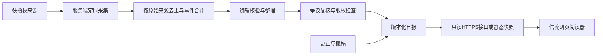

# 信流：网页版实施方案

更新时间：2026-10-30。产品已调整为网页，不再开发鸿蒙客户端。名称统一为「信流」，英文仓库名`xinliu`。

## 产品与阅读预算

每天一份、读完即止的中文简报，四栏分别安排：时政6分钟、AI 5分钟、社会热点5分钟、艺术4分钟。约8–11个条目，18–22分钟为允许范围；初始按350中文阅读单位/分钟估算，并以真实读者测试校准。

当前样刊只有约5分钟的原创演示说明，不对应真实新闻。界面明确标注样刊日期，不自动换成今天，不伪装成实时资讯。保存、搜索和阅读进度已能在浏览器使用。

## 当前架构

静态HTML/CSS + 原生JavaScript ES Module，托管到GitHub Pages或Sites。没有构建依赖，没有客户端密钥。样刊数据随站点发布；收藏、字号、主题和已读保存在`localStorage`中。清除数据只操作`xinliu:v1`键，不清除其他网站数据。

界面采用纸张色、暖红强调色与阅读字体。桌面显示阅读目录和卡片，手机改为横向栏目。文章用原生`dialog`呈现，支持Esc退出、字号调整、外链新窗口和深色模式。收藏/未读均可组合筛选，搜索覆盖标题、摘要、正文和观点。

## 真实日报的后续架构

先用Node.js服务与PostgreSQL管理来源、稿件、授权、审核、期刊、更正和撤稿。来源API密钥只保存在服务端环境变量。公众接口仅返回已批准的内容、来源、版本、发布时间与离线有效期；不返回合同、编辑账号或内部凭证。

首次可由编辑人工整理并审核一份JSON，再通过受控流程发布；无需一开始引入微服务。修改正文后原审批失效，以内容哈希绑定审核结果。发布时写入不可变版本，再原子更新最新版本指针。

## 新鲜度与每日提醒

建议上海时间08:00发布、07:30截稿，覆盖截至截稿的重要进展。分别记录事件发生、来源发布、检索、核验和期刊更新时间；背景材料单独标识。无合格日报时保留真实期刊日期并说明尚未更新，不用旧文换日期。

当前网站只保存阅读状态，不缓存新闻正文，也没有后台更新、浏览器通知或订阅。后续先做“打开网站时检查新一期”，再根据实际设备兼容性考虑Web Push/PWA。订阅必须由用户主动开启，可随时关闭；浏览器限制与网络状况意味着不能保证08:00准时送达。GitHub Pages自身不提供采集服务或定时推送。

## 编辑平衡与争议处理

条目使用“发生了什么、为什么重要、证据、各方说法、尚不确定、原文”的固定结构。重要争议追溯一手材料和至少两条独立证据链，由不同编辑复核；两家网站转载同一稿件算同一来源。

不因存在争议而排除重要议题，也不为凑平衡而给已证伪说法同等权重。明确区分指控、调查、事实与评价。给被指称方回应机会，不编造回应；证据不足则说明限制或等待核实。保护普通人、受害者及未成年人身份信息，避免煽动性标题。

保留显著更正记录和纠错入口；重大错误先撤回或提示，再核验修订。关注来源集中度、议题与地域覆盖、回应覆盖和更正响应速度，不能仅用点击量选题。

## 授权、运营与AI

API订阅、内容版权与新闻运营许可分别核实。合同要覆盖客户端/网页展示、摘要、翻译、模型输入、图片、缓存、推送、地区、期限、署名及撤稿。RSS和公开网页不构成自动转载许可。

默认按中国大陆中文用户规划。对时政及社会公共事务新闻，公开运营需核实对应新闻信息服务许可、APP或网站相关备案和平台要求；网站形式不自动免除相关责任。可与合适的持证机构探讨由其实际运营、承担内容责任，你提供技术。不能用购买API或借用许可证代替实际资格。

AI只能处理被允许用于该用途的材料，提供草稿与整理建议；事实、引语、日期、数字、翻译和来源由编辑核对。生成内容按适用规则落实标识和溯源；不能认为加一个“AI辅助”提示就完成全部标识要求。详见来源与授权调研。

## 隐私

当前版本免登录、无广告或统计SDK；不收集定位、通讯录或阅读画像。记录仅保存在这个浏览器，GitHub/Sites等托管服务仍会处理必要的网络请求信息，来源外链适用原网站规则。

未来接入账号、推送或反馈前，明确字段、用途、保存期限、删除入口和服务商。Token不得写入日志，读者身份或阅读记录不发送给新闻供应商。数据同步与账号功能另行设计，不在当前静态站暗中加入。

## 六阶段实施与验收

1. **网页原型（当前交付）**：四栏、搜索、详情、收藏、已读、字号、深色、清除数据；手机和桌面验证。
2. **内容准备**：确定运营主体与来源合同，人工编辑一份真实获授权的试刊；检查证据映射和20分钟实读预算。
3. **内容后台**：来源/授权台账、草稿、审核、第二人复核、修改后重审、版本化发布与撤稿。
4. **真实日更**：定时采集、去重、失败重试、截稿检查、发布告警；连续稳定运行至少7天。
5. **阅读完善**：历史期刊、到期处理、更正同步、可访问性和弱网测试；只有许可允许的内容才缓存。
6. **可选提醒**：按用户主动选择接入提醒，维护订阅、取消和去重，验证设备兼容性。

原型不等于正式新闻服务。当前自动测试覆盖筛选组合、持久化异常、链接安全和样刊结构；浏览器验证记录另列在仓库文档中。上线真实内容前需进行授权到期、撤稿、跨日、弱网、通知拒绝和数据删除演练。
